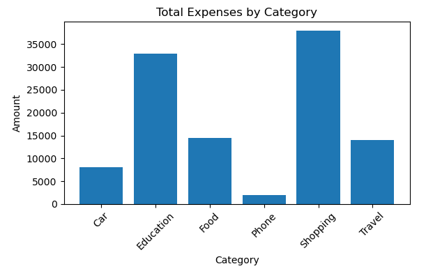
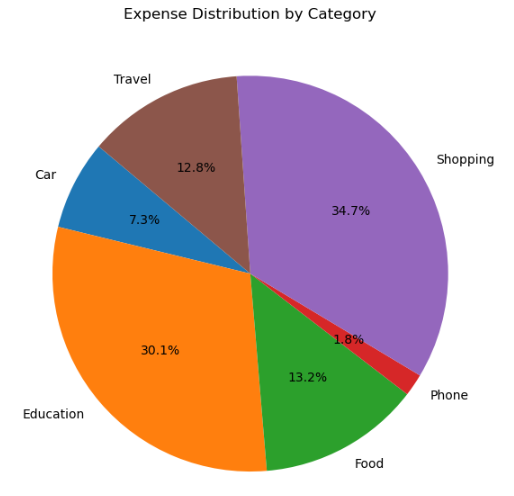
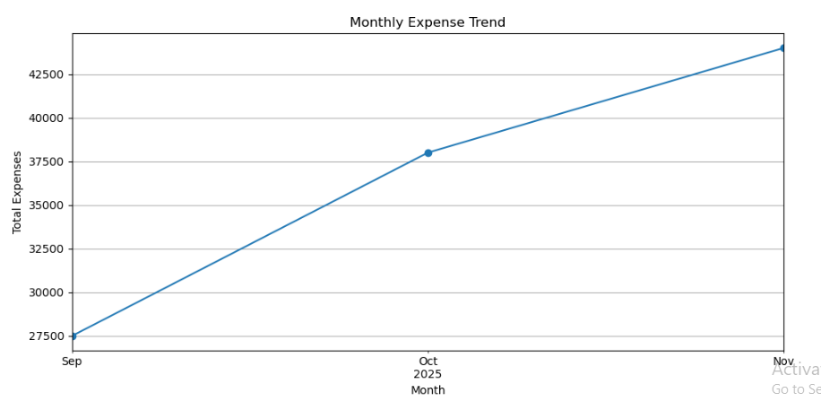

# Personal Expense Tracker — Python & Visual Reports

A small **Python data-management and analysis project** for logging spending, categorizing transactions, reviewing expenses, and visualizing patterns over time.

This project demonstrates how basic data entry can be turned into reports that help answer questions such as: *Where is money being spent? Which categories cost the most? How does spending change by month?*

## What it includes

- Enter an expense with **amount, date, category, and note**
- Review saved expense records
- Filter spending by date or category
- Export records for analysis
- Generate a **bar chart**, **pie chart**, and **monthly trend chart**
- Reset recorded data through the menu workflow

## Report previews

| Category totals | Share by category |
| --- | --- |
|  |  |



## Explore the project

| File | Purpose |
| --- | --- |
| [`Model/expense_tracker.ipynb`](Model/expense_tracker.ipynb) | Jupyter notebook copy of the project's interactive Python code |
| [`Model/expense_tracker.py`](Model/expense_tracker.py) | Original legacy file (contains notebook-formatted JSON despite the `.py` name) |
| [`Model/expenses.json`](Model/expenses.json) | Sample stored expense records |
| [`Model/Data/expenses.csv`](Model/Data/expenses.csv) | CSV example |
| [`Model/User_Guide.docx`](Model/User_Guide.docx) | User guide |
| [`Model/README.md`](Model/README.md) | Earlier project notes |

## Run the notebook

Install Python, Jupyter, Pandas, and Matplotlib:

```bash
python -m pip install notebook pandas matplotlib
cd Model
jupyter notebook expense_tracker.ipynb
```

Run the notebook's code in an interactive environment, with `Model/` as the working directory so the code can read `expenses.json`.

**Technical note:** The original `expense_tracker.py` in this repository is actually serialized notebook JSON and cannot be executed as a normal Python script. This documentation refresh adds `expense_tracker.ipynb` without deleting or changing the original file.

## Data and skills

**Skills demonstrated:** Python · JSON/CSV file handling · Pandas · Matplotlib · Data Visualization · Exploratory Spending Analysis

This is a learning/portfolio application rather than a financial service. Be careful not to commit real personal financial records.

---

**Author:** [Aqsa Mansoor](https://github.com/AqsaMansoor32) · [GitHub portfolio](https://github.com/AqsaMansoor32)
